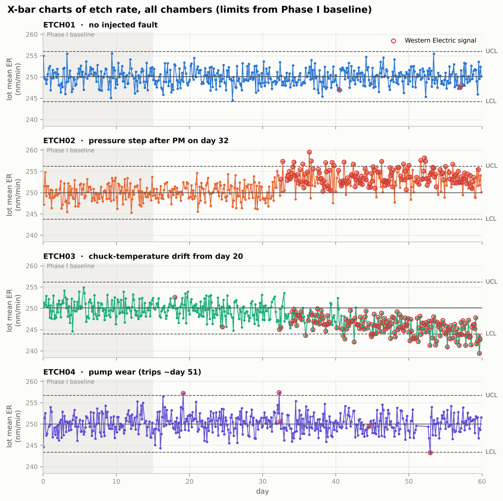
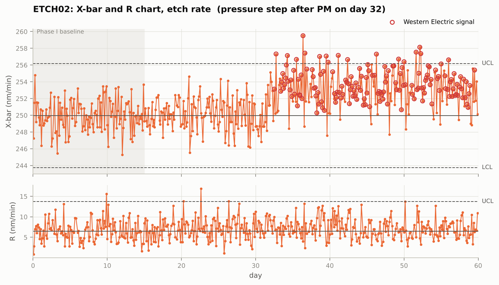
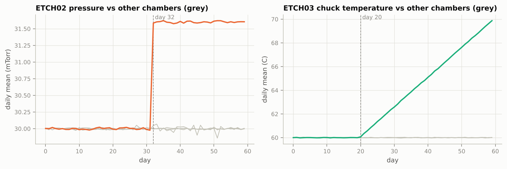
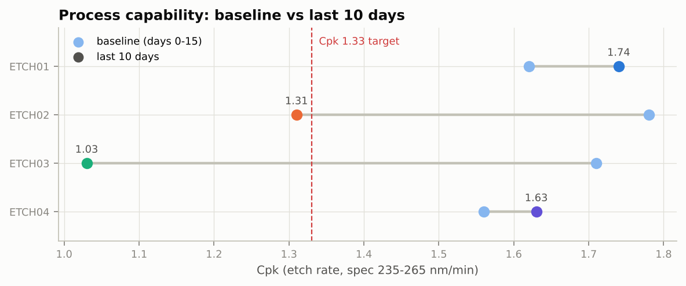
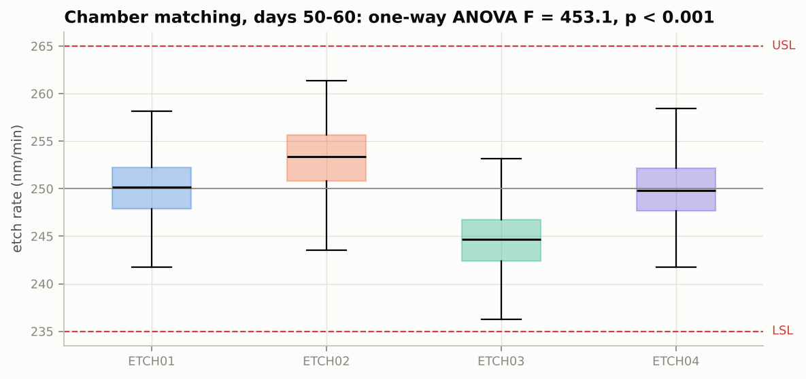
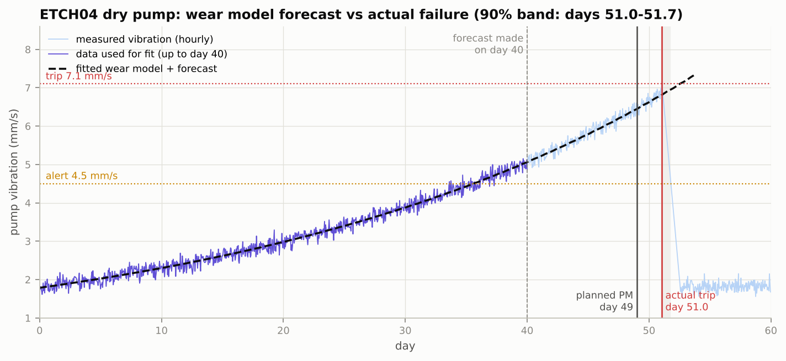
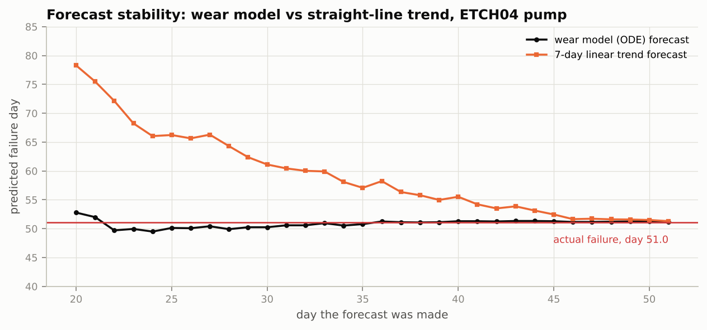
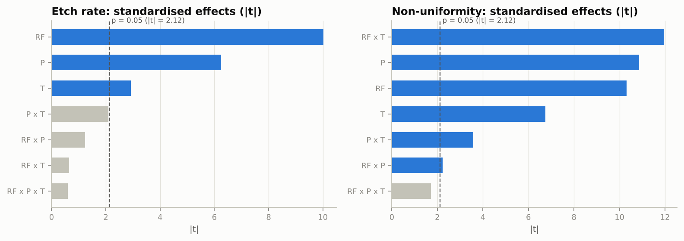
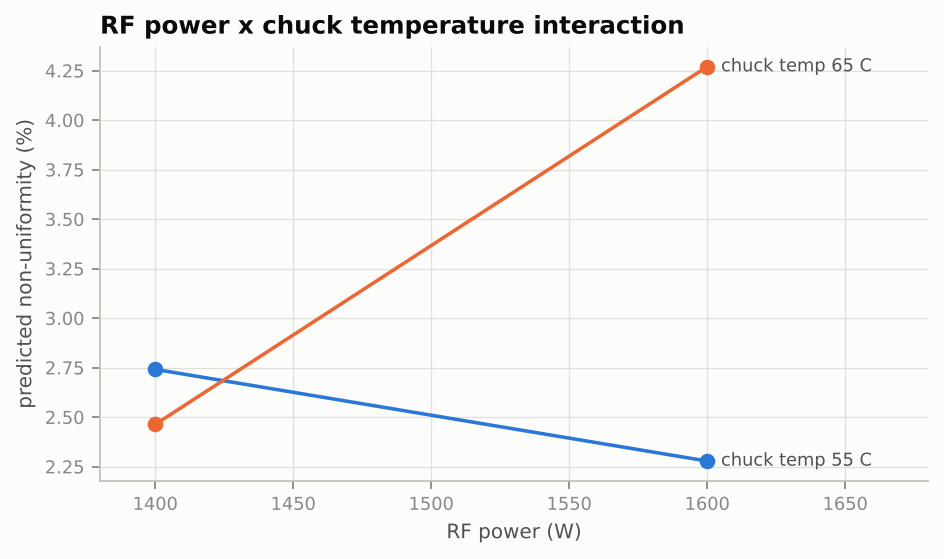

# Automated Process Monitoring, SPC and Predictive Maintenance for a Semiconductor Etch Module

An end-to-end pipeline that simulates high-volume manufacturing (HVM) telemetry from four plasma-etch chambers. It extracts and cleans the data from SQL, detects process shifts with statistical process control, forecasts a vacuum-pump failure with a differential-equation wear model (Python and MATLAB), optimises the recipe with a designed experiment, and documents the work as an 8D / DMAIC report with an FMEA.

**Author:** Rachana Santhebachahalli Umesha · Personal project, 2026
**Note:** all data is simulated. Faults are injected on purpose so the methods can be tested against a known answer.

## Results at a glance

| Area | Result |
| --- | --- |
| Data | 63,154 raw records in 3 SQL tables; 538 bad rows removed or repaired automatically |
| SPC: pressure step (ETCH02, day 32) | Detected **0.5 days** after the event |
| SPC: slow temperature drift (ETCH03, day 20) | First signal day 24.5; continuous alarms from day 32 |
| False alarms on the healthy chamber | **3** in 355 lots with three-way chart limits (textbook X-bar limits: 18) |
| Capability | ETCH03 Cpk fell from 1.71 to **1.03**; ETCH02 from 1.78 to **1.31** |
| Chamber matching (ANOVA) | Days 0-15: p = 0.91 (matched). Days 50-60: F = 453, p < 0.001 |
| Pump failure forecast (made on day 40) | Predicted day **51.3** (90% range 51.0-51.7); actual failure day **51.0**; a straight-line trend said 55.5 |
| Planned maintenance | Pump swap scheduled for day 49, 2 days before the failure |
| DOE recipe change | Non-uniformity 3.39% → **2.82%**; Ppk (non-uniformity) 0.64 → **1.30**; yield 97.0% → **100%** (200 confirmation wafers) |
| FMEA | Total RPN 1035 → 351 after the actions |

## Pipeline

```
simulate.py      60 days x 4 chambers -> SQLite (wafer_runs, metrology, pump_telemetry)
     │           with injected faults + missing values, duplicates and -999 sensor dropouts
etl.py           SQL extraction (SQLAlchemy / pandas), range checks, de-duplication,
     │           lot subgroups (n = 5), daily sensor means, data-quality report
spc.py           X-bar / R charts, Western Electric rules 1-4, Cp / Cpk / Ppk, yield,
     │           one-way ANOVA + Tukey HSD, root-cause sensor trace
reliability.py   pump wear ODE fitted by least squares, residual bootstrap,
     │           failure forecast and PM day   (MATLAB version: matlab/pump_degradation.m)
doe.py           2^3 full factorial + centre points, effects and t-tests,
                 constrained optimisation, confirmation runs
```

## 1. Data extraction and cleaning

The simulator writes 47,843 wafer sensor records (RF power, pressure, chuck temperature, gas flow, endpoint time), 9,569 metrology results (etch rate and non-uniformity on 5 of 25 wafers per lot) and 5,742 hourly pump readings. Like real logs, the data has gaps, re-sent duplicate rows and -999 sentinel values.

`etl.py` pulls each table with SQL, removes duplicates, sets physically impossible values to missing, interpolates short gaps in the pump signal and keeps only complete 5-wafer subgroups. Each rule's row count goes to `outputs/data_quality_report.csv`.

## 2. Statistical process control



Control limits come from a Phase I baseline (days 0-15). Each later lot is checked against four Western Electric rules: 1 point beyond 3σ, 2 of 3 beyond 2σ, 4 of 5 beyond 1σ, and 8 in a row on one side.

**Why a three-way chart.** Etch rate varies from lot to lot as well as wafer to wafer. Textbook X-bar limits (X̿ ± A2·R̄) only see the within-lot spread, so they are too tight: on the healthy chamber they gave 18 false alarms. Limits based on the moving range of lot means include the lot-to-lot variation and cut this to 3, while the R chart still watches within-lot spread.



**Root cause.** Each SPC signal traces back to a chamber sensor: the ETCH02 pressure stepped up 1.6 mTorr after its PM on day 32, and the ETCH03 chuck temperature drifted up from day 20.







## 3. Equipment reliability: pump wear model

Wear speeds up as damage accumulates, so the model is

```
dD/dt = k · u(t) · (1 + D / Dc)      V(t) = V0 + D(t)
```

Here u(t) is the pump duty cycle and V is vibration in mm/s. The parameters k, Dc and V0 are fitted to the vibration history up to day 40, and the ODE is integrated forward. A residual bootstrap of 300 refits gives a range for the failure day. The interlock trips on a single reading above 7.1 mm/s, so the forecast uses the point where the *mean* comes within two noise standard deviations of the limit.



The wear model locked on to the right failure day about 25 days ahead. A straight-line trend over the last 7 days stayed late until almost the end, because it cannot follow the acceleration.



**MATLAB.** `matlab/pump_degradation.m` fits the same model with `ode45` and `fminsearch`, using base MATLAB only. Run `run_pipeline.py` first, then run the script in MATLAB. Expected output: k ≈ 0.0526 /day, Dc ≈ 1.61, V0 ≈ 1.78 mm/s, predicted failure on day ≈ 51.3. The figure is saved as `matlab/pump_forecast_matlab.png`.

## 4. Design of experiments

The design is a 2³ full factorial on RF power (1400 / 1600 W), pressure (28 / 32 mTorr) and chuck temperature (55 / 65 °C), with 3 replicates and 4 centre points (28 wafers). The centre points showed no significant curvature (p = 0.80 for etch rate, p = 0.66 for non-uniformity), so a linear model with interactions is adequate.



Non-uniformity is driven mainly by the **RF power × chuck temperature interaction**. At 55 °C, more RF power improves uniformity; at 65 °C it makes it worse.



The fitted models were searched for the setting that keeps etch rate within ±1 nm/min of target while minimising non-uniformity. The first confirmation run came out 2.4 nm/min high, so etch rate was re-centred with RF power using the fitted slope.

| | Old recipe | New recipe |
| --- | --- | --- |
| Setting | 1500 W / 30 mTorr / 60 °C | 1428 W / 32 mTorr / 55 °C |
| Mean etch rate (nm/min) | 250.0 | 249.5 |
| Mean non-uniformity (%) | 3.39 | 2.82 |
| Ppk, non-uniformity (USL 4%) | 0.64 | 1.30 |
| Ppk, etch rate | 1.55 | 1.51 |
| Wafers in spec | 97.0% | 100% |

## 5. 8D / DMAIC report and FMEA

See [reports/8D_DMAIC_report.md](reports/8D_DMAIC_report.md) and `outputs/fmea_ranked.csv`.

## Run it

```bash
pip install -r requirements.txt
python run_pipeline.py          # about 10 seconds; writes data/ and outputs/
```

Then, optionally, run `matlab/pump_degradation.m` in MATLAB or MATLAB Online.

## Repository layout

```
run_pipeline.py          runs every stage
src/                     simulate, etl, spc, reliability, doe, plotting, config
matlab/                  pump_degradation.m (ode45 + fminsearch)
reports/                 8D_DMAIC_report.md, fmea.csv
outputs/                 result tables, summary.json, figures/
```
